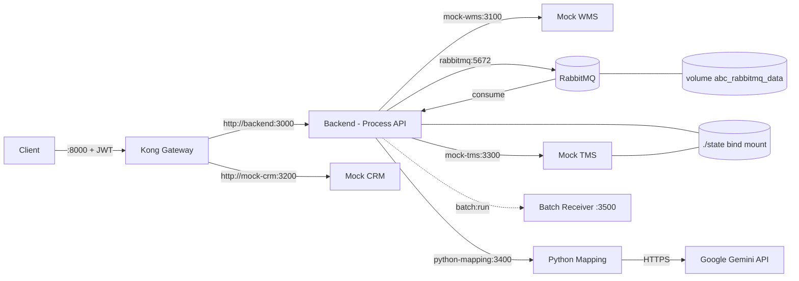
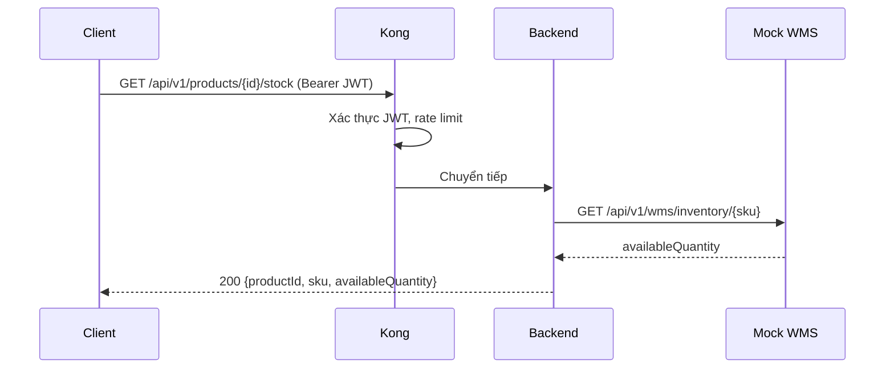
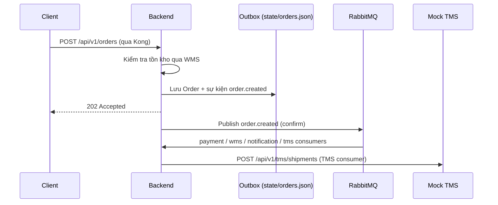
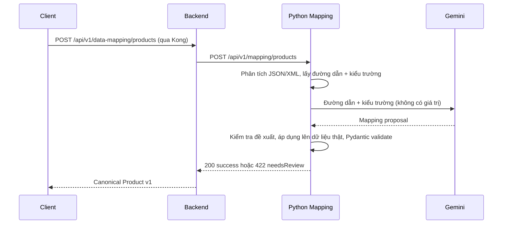

# ABC Retail – System Integration

Dự án môn **SE445C – Tích hợp hệ thống**: nền tảng tích hợp cho chuỗi bán lẻ ABC Retail, minh họa tích hợp **đồng bộ**, **bất đồng bộ**, **theo lô** và **chuyển đổi dữ liệu có hỗ trợ AI**, toàn bộ chạy được bằng **một file `docker-compose.yml`**.

## Mục lục

1. [Tổng quan](#1-tổng-quan)
2. [Kiến trúc hệ thống](#2-kiến-trúc-hệ-thống)
3. [Công nghệ sử dụng](#3-công-nghệ-sử-dụng)
4. [Cấu trúc dự án](#4-cấu-trúc-dự-án)
5. [Yêu cầu cài đặt](#5-yêu-cầu-cài-đặt)
6. [Cấu hình môi trường](#6-cấu-hình-môi-trường)
7. [Cài đặt và khởi động](#7-cài-đặt-và-khởi-động)
8. [API và xác thực](#8-api-và-xác-thực)
9. [Năm kịch bản chạy thử](#9-năm-kịch-bản-chạy-thử)
10. [Kiểm thử tự động](#10-kiểm-thử-tự-động)
11. [Giới hạn đã biết](#11-giới-hạn-đã-biết)
12. [Xử lý sự cố](#12-xử-lý-sự-cố)

---

## 1. Tổng quan

**Bối cảnh.** ABC Retail có nhiều cửa hàng và kênh thương mại điện tử. Các hệ thống (kho WMS, vận chuyển TMS, CRM, website…) từng tích hợp điểm–điểm nên khó đồng bộ dữ liệu và xử lý đơn hàng. Dự án đề xuất một lớp tích hợp kết hợp **API-led connectivity** (API Gateway + Process API) và **Event-Driven Architecture** (RabbitMQ).

**Chức năng chính**

| Nhóm | Chức năng |
| --- | --- |
| Đồng bộ | Tra cứu tồn kho theo SKU / Product ID theo thời gian thực qua Kong → Backend → WMS |
| Bất đồng bộ | Tạo đơn hàng, lưu Outbox, phát sự kiện `order.created`, bốn consumer độc lập, retry và Dead Letter Queue |
| Theo lô | Đọc danh mục sản phẩm CSV/JSON, chia lô 100 bản ghi, gửi REST, lưu lô lỗi để chạy lại, lịch 00:00 |
| AI Data Mapping | Chuyển dữ liệu sản phẩm legacy JSON/XML sang **Canonical Product v1** bằng Gemini + kiểm tra cục bộ |
| CRM demo | Mock CRM cập nhật tổng điểm khách hàng qua API |
| Batch Receiver | Nhận, kiểm tra, lưu và truy vấn các batch sản phẩm |
| Vận hành | Một Docker Compose gồm 8 service có healthcheck và Docker DNS nội bộ |

Các thành phần **Payment, Notification, WMS reservation** là handler mô phỏng (ghi log). Mock CRM và Batch Receiver là dịch vụ demo, không kết nối hệ thống thật của retailer.

## 2. Kiến trúc hệ thống

### Vai trò từng thành phần

| Thành phần | Vai trò |
| --- | --- |
| **Client** | Gửi request tới hệ thống qua Kong (`http://localhost:8000`) |
| **Kong API Gateway** | Cổng vào duy nhất: kiểm tra **JWT**, **định tuyến** `/api/v1/*` tới Backend, **rate limiting** 100 request/phút/IP. Kong là API Gateway, **không** phải Integration Layer |
| **Backend (Node.js/Express)** | **Integration Service / Process API**: xác thực dữ liệu đầu vào, gọi WMS, tạo đơn, ghi Outbox, publish/consume RabbitMQ, gọi Python Mapping |
| **Mock WMS** | System API kho giả lập: trả tồn kho theo SKU |
| **Mock TMS** | System API vận chuyển giả lập: tạo shipment idempotent theo `eventId` |
| **Mock CRM** | API demo độc lập để thay tổng điểm loyalty của khách hàng |
| **Batch Receiver** | API nội bộ nhận và persist batch product; mô phỏng một website/chi nhánh |
| **RabbitMQ** | **Event Broker**: exchange/queue/routing key, ACK/NACK, retry theo TTL, DLQ |
| **Python Mapping (FastAPI)** | Phân tích JSON/XML, xin Gemini đề xuất mapping, tự áp dụng mapping và kiểm tra bằng Pydantic |
| **Google Gemini API** | Chỉ **đề xuất** ánh xạ trường nguồn → trường Canonical; nhận tên/kiểu trường, không nhận giá trị dữ liệu |

### Sơ đồ triển khai (Docker Compose)



Chỉ hai cổng được publish ra máy chủ: **8000** (Kong) và **15672** (RabbitMQ Management). Các service còn lại giao tiếp trong mạng bridge `integration` bằng tên service. CRM được expose qua route Kong bảo vệ JWT; Batch Receiver chỉ dùng nội bộ.

### Luồng đồng bộ

`Client → Kong → Backend → WMS Adapter → Mock WMS → Backend → Client`



### Luồng bất đồng bộ

`Client → Kong → Backend → Outbox → RabbitMQ → Consumers → Mock TMS / Payment / Notification`



Backend trả `202` ngay sau khi lưu Order và Outbox, không chờ consumer. Nếu RabbitMQ tạm mất, sự kiện nằm lại trong Outbox và được publish khi kết nối lại.

### Luồng AI Data Mapping

`Client → Kong → Backend → Python Mapping → Gemini → Mapping Proposal → Validation → Canonical JSON`



### Topology RabbitMQ

| Exchange | Loại | Mục đích |
| --- | --- | --- |
| `abc.events` | topic | Nhận `order.created`, phân phối tới 4 queue |
| `abc.dead-letter` | direct | Chuyển message lỗi vào DLQ của từng consumer |
| `abc.wms.retry`, `abc.tms.retry` | direct | Đưa message hết TTL retry quay về queue chính |

| Consumer | Queue chính | Khi lỗi |
| --- | --- | --- |
| Payment | `payment.order-created` | Vào thẳng `payment.order-created.dlq` |
| WMS | `wms.order-created` | `wms.order-created.retry` → tối đa 3 lần → `wms.order-created.dlq` |
| Notification | `notification.order-created` | Vào thẳng `notification.order-created.dlq` |
| TMS | `tms.order-created` | `tms.order-created.retry` → tối đa 3 lần → `tms.order-created.dlq` |

Mỗi consumer lưu `eventId` đã xử lý trong `state/consumers/` để bỏ qua message giao lặp.

## 3. Công nghệ sử dụng

| Công nghệ | Phiên bản / ghi chú | Sử dụng |
| --- | --- | --- |
| Node.js, Express.js | Image `node:22-bookworm-slim` (`engines`: ≥ 20) | Backend, Mock WMS/TMS/CRM, Batch Receiver, sender |
| Python, FastAPI, Uvicorn | Image `python:3.13-slim` | Mapping Service |
| Pydantic, `defusedxml`, `python-dotenv` | Theo `ai_mapping/requirements.txt` | Validate Canonical Product, parse XML an toàn, đọc `.env` |
| Google Gemini API | Mặc định `gemini-3.5-flash-lite`; gọi REST bằng thư viện chuẩn, không dùng SDK | Đề xuất mapping |
| Kong Gateway | **3.9.4**, DB-less, cấu hình khai báo `kong/kong.yml` | JWT, rate limiting, routing |
| RabbitMQ | **4.4.0** (image cố định theo digest trong Compose), `amqplib` | Event broker |
| Docker, Docker Compose | Compose v2 (`docker compose`) | Đóng gói và chạy toàn hệ thống |
| OpenAPI 3.0.3, `swagger-ui-express` | `openapi/openapi.json` | Hợp đồng API, Swagger UI |
| `node-cron`, `csv-parse` | | Lịch batch 00:00, đọc CSV |
| Node test runner, Python `unittest` | | Kiểm thử tự động |

## 4. Cấu trúc dự án

```text
.
├── ai_mapping/                  # Python Mapping Service (FastAPI)
│   ├── app.py                   # FastAPI app, /health, /api/v1/mapping/products
│   ├── gemini_client.py         # Gọi Gemini REST, structured output
│   ├── product_mapper.py        # Kiểm tra proposal, áp dụng mapping, validate
│   ├── source_parser.py         # Parse JSON/XML thành đường dẫn trường
│   ├── models.py, errors.py, settings.py
│   ├── tests/                   # unittest (Gemini được mock)
│   ├── Dockerfile
│   ├── requirements.txt
│   └── .env.example             # Mẫu cấu hình Gemini (không chứa key)
├── data/products.json           # Danh mục mẫu 200 sản phẩm (SKU-0001 … SKU-0200)
├── kong/kong.yml                # Kong DB-less: service, route, JWT, rate limiting
├── openapi/openapi.json         # Đặc tả OpenAPI 3.0.3
├── src/
│   ├── app.js, server.js, config.js, logger.js, errors.js
│   ├── routes/, controllers/    # Inventory, Product stock, Order, Data mapping
│   ├── services/                # Inventory, Order, Outbox
│   ├── integrations/            # Adapter WMS, TMS, Data mapping
│   ├── messaging/               # Topology, runtime RabbitMQ, consumers, retry policy
│   ├── repositories/            # Lưu JSON: orders/outbox, consumers, shipments, CRM, batch
│   ├── mocks/wms, mocks/tms/    # Mock WMS và Mock TMS
│   ├── mocks/crm/               # Mock CRM loyalty-points API
│   ├── mocks/batch-receiver/    # Receiver tương thích batch sender
│   └── batch/                   # Reader, batch service, sender, CLI, scheduler
├── tests/                       # Node.js tests
├── docker-compose.yml           # 8 service, cùng Docker network
├── Dockerfile                   # Image dùng chung cho Node services
├── .dockerignore
├── .env.example                 # Mẫu cấu hình khi chạy Node trực tiếp (không dùng Docker)
├── package.json, package-lock.json
├── runtime/.env.backend.example # Template an toàn, không chứa credential
├── runtime/.env.backend         # (tự tạo, Git bỏ qua) RABBITMQ_URL cho Backend
└── state/                       # (tự sinh, Git bỏ qua) Order, Outbox, consumer, shipment
```

## 5. Yêu cầu cài đặt

| Yêu cầu | Dùng cho | Kiểm tra |
| --- | --- | --- |
| Git | Tải mã nguồn | `git --version` |
| Docker Desktop + Compose v2 | Chạy toàn hệ thống | `docker --version`, `docker compose version` |
| Gemini API key | Chỉ Scenario 4 | Xem [mục 6](#gemini-api-key) |
| Node.js ≥ 20 | Chỉ khi chạy test/batch trên máy chủ | `node --version` |
| Python ≥ 3.11 | Chỉ khi chạy test Python trên máy chủ | `py -3 --version` |

Xác nhận Docker hoạt động (Docker Desktop phải đang chạy):

```powershell
docker info --format '{{.ServerVersion}}'
docker run --rm hello-world
```

Các lệnh trong tài liệu dùng **PowerShell** trên Windows; `curl.exe` có sẵn từ Windows 10.

## 6. Cấu hình môi trường

Docker Compose cần **hai file env không nằm trong Git** và một RabbitMQ volume.

| File / tài nguyên | Dùng cho | Ghi chú |
| --- | --- | --- |
| `runtime/.env.backend.example` | Mẫu cho Backend | Placeholder, không chứa credential |
| `runtime/.env.backend` | Backend | Chỉ chứa `RABBITMQ_URL`, Git bỏ qua |
| `ai_mapping/.env` | Python Mapping | Chứa `GEMINI_API_KEY`, `GEMINI_MODEL`, `GEMINI_TIMEOUT_MS`; chỉ service này nhận key |
| Volume `abc_rabbitmq_data` | RabbitMQ | Hiện khai báo `external: true`, phải tồn tại trước khi chạy |
| `.env` ở thư mục gốc | Chỉ khi chạy Node trực tiếp | Sao chép từ `.env.example`; **Compose không dùng file này** và `.dockerignore` loại nó khỏi image |

### RabbitMQ và `runtime/.env.backend`

**Hiện trạng:** Compose vẫn dùng external volume `abc_rabbitmq_data` để bảo vệ volume đang có dữ liệu. Trên máy mới, tạm thời cần tạo volume trước:

```powershell
docker volume create abc_rabbitmq_data
New-Item -ItemType Directory -Force runtime | Out-Null
Copy-Item runtime\.env.backend.example runtime\.env.backend
code runtime\.env.backend
```

- Hostname trong URL phải là `rabbitmq` (tên service trong Compose). Với volume đã có dữ liệu, dùng đúng user/password đã được khởi tạo cho volume đó; không thay bằng credential mặc định của broker mới.
- Với volume mới, dùng đúng account mà RabbitMQ image khởi tạo trên data directory rỗng; không commit giá trị đó hay đưa credential vào `docker-compose.yml`.
- `RABBITMQ_DEFAULT_USER`/`RABBITMQ_DEFAULT_PASS` (nếu cấu hình) chỉ bootstrap user cho node mới, không thay đổi user trong data directory đã tồn tại. URL-encode ký tự đặc biệt trong credential.
- Không commit file này; `.gitignore` đã bỏ qua `runtime/.env.backend`.
- `docker compose down -v` không xóa external volume. Không tự xóa volume này (`docker volume rm`) vì sẽ mất queue, DLQ và tài khoản.

**Migration sang named volume do Compose quản lý đang chờ phê duyệt.** Kế hoạch là dừng broker, sao lưu lạnh, copy data directory (giữ node `rabbit@abc-rabbitmq`, file ownership và credential database) sang một named volume mới, khởi động duy nhất một broker với volume mới, rồi đối chiếu queue/DLQ metadata. Chỉ sau khi được duyệt mới đổi Compose. Máy mới khi đó không cần tạo volume thủ công. Lưu ý: `docker compose down` giữ named volume; `docker compose down -v` xóa named volume RabbitMQ và sẽ xóa queue/DLQ/user database. Không chạy `down -v` nếu cần giữ dữ liệu.

### Gemini API key

1. Tạo key tại [Google AI Studio](https://aistudio.google.com/apikey).
2. Tạo file cấu hình rồi mở trong editor để điền key (không dán key vào chat, issue hay README):

   ```powershell
   Copy-Item ai_mapping\.env.example ai_mapping\.env
   code ai_mapping\.env
   ```

| Biến | Mặc định | Ý nghĩa |
| --- | --- | --- |
| `GEMINI_API_KEY` | rỗng | Khóa API. Để trống thì hệ thống vẫn khởi động nhưng Scenario 4 trả 503 |
| `GEMINI_MODEL` | `gemini-3.5-flash-lite` | Model dùng cho mapping; phải được key của bạn cho phép |
| `GEMINI_TIMEOUT_MS` | `30000` | Thời gian chờ Python → Gemini (ms) |

`ai_mapping/.env` bị Git và Docker build bỏ qua; Compose chỉ nạp file này cho service `python-mapping`. Không đặt key vào `.env` ở thư mục gốc hay `runtime/.env.backend`. Dùng **dữ liệu giả lập** khi gọi Gemini; hạn mức và chính sách dữ liệu của gói miễn phí do Google quy định, hãy kiểm tra trên [trang tài liệu Gemini](https://ai.google.dev/gemini-api/docs).

### Biến môi trường Backend (đã đặt sẵn trong Compose)

| Biến | Giá trị trong Compose |
| --- | --- |
| `PORT`, `HEALTHCHECK_PORT` | `3000` |
| `WMS_MODE` | `http` |
| `WMS_BASE_URL` | `http://mock-wms:3100/api/v1/wms` |
| `TMS_BASE_URL` | `http://mock-tms:3300/api/v1/tms` |
| `CRM_MOCK_PORT` | `3200` (Mock CRM) |
| `AI_MAPPING_SERVICE_URL` | `http://python-mapping:3400` |
| `BATCH_TARGET_URL` | `http://batch-receiver:3500/api/v1/products/batch` |
| `BATCH_RECEIVER_PORT` | `3500` |
| `STATE_DIR` | `/app/state` (bind mount `./state`) |
| `RABBITMQ_URL` | Từ `runtime/.env.backend` |

Mock WMS nhận `WMS_MOCK_INVENTORY` = `SKU-0001: 50`, `SKU123: 50`, `SKU-LOW-STOCK: 2`, `SKU-OUT-OF-STOCK: 0`. Compose đặt sẵn bốn SKU này. Các biến khác (timeout, retry TTL `WMS_RETRY_DELAY_MS=5000`, reconnect…) dùng mặc định trong `src/config.js`.

## 7. Cài đặt và khởi động

```powershell
git clone <repository-url>
Set-Location <thư-mục-dự-án>

# Chuẩn bị cấu hình (xem mục 6)
docker volume create abc_rabbitmq_data
New-Item -ItemType Directory -Force runtime | Out-Null
Copy-Item runtime\.env.backend.example runtime\.env.backend
code runtime\.env.backend
Copy-Item ai_mapping\.env.example ai_mapping\.env     # rồi điền GEMINI_API_KEY nếu chạy Scenario 4

docker compose config --no-env-resolution --quiet     # kiểm tra cú pháp, không in giá trị
docker compose up --build -d
docker compose ps
docker compose logs -f
```

Thay `<repository-url>` và `<thư-mục-dự-án>` bằng giá trị của bạn. Nếu volume `abc_rabbitmq_data` hoặc hai file env đã tồn tại, bỏ qua bước tạo tương ứng (đừng ghi đè).

### Kiểm tra sức khỏe

Tám service phải ở trạng thái `running (healthy)`:

```powershell
docker compose ps
```

Backend, Mock WMS, Mock TMS, Mock CRM, Batch Receiver và Python Mapping **không publish cổng ra máy chủ**, nên kiểm tra `/health` từ trong mạng Docker:

```powershell
docker compose exec -T backend node -e "for (const u of ['http://127.0.0.1:3000/health','http://mock-wms:3100/health','http://mock-tms:3300/health','http://mock-crm:3200/health','http://batch-receiver:3500/health','http://python-mapping:3400/health']) fetch(u).then(r => console.log(u, r.status))"
```

Kong: trạng thái `healthy` của `docker compose ps` (Docker chạy `kong health`). Route gốc `/` của Kong không được cấu hình nên trả 404 – đó **không** phải dấu hiệu lỗi. RabbitMQ:

```powershell
docker compose exec -T rabbitmq rabbitmq-diagnostics -q check_running
```

### Cổng sử dụng

| Cổng | Service | Truy cập từ máy chủ |
| --- | --- | --- |
| `8000` | Kong Proxy | Có – `http://localhost:8000` |
| `15672` | RabbitMQ Management | Có – `http://localhost:15672` |
| `5672` | RabbitMQ AMQP | Không – chỉ trong mạng Docker |
| `3000` / `3100` / `3200` / `3300` / `3400` / `3500` | Backend / Mock WMS / CRM / Mock TMS / Python Mapping / Batch Receiver | Không – chỉ trong mạng Docker |

Nếu cổng `8000` hoặc `15672` đã bị chiếm, Compose không khởi động được Kong/RabbitMQ (xem [mục 12](#12-xử-lý-sự-cố)).

### Dừng hệ thống an toàn

| Lệnh | Tác dụng |
| --- | --- |
| `docker compose stop` | Dừng container, **giữ** container, mạng và dữ liệu. Chạy lại bằng `docker compose start` |
| `docker compose down` | Xóa container và mạng của Compose. `state/` (bind mount) và volume `abc_rabbitmq_data` (external) **vẫn còn** |
| `docker compose down -v` | Thêm việc xóa volume do Compose quản lý. Với file hiện tại volume RabbitMQ là `external` nên không bị xóa, nhưng **đừng dùng tùy tiện**: nếu cấu hình bị đổi sang volume thông thường, queue, DLQ và dữ liệu sẽ mất |

Không dùng `docker volume rm abc_rabbitmq_data`, `docker system prune --volumes` hoặc xóa thư mục `state/` khi chưa sao lưu: các thao tác này làm mất Order, Outbox, Shipment, queue và DLQ.

## 8. API và xác thực

### Xác thực JWT và rate limiting tại Kong

- Plugin `jwt` và `rate-limiting` gắn ở cấp **service**, nên các API public `/api/v1/*` đều cần JWT: inventory, product stock, orders, data-mapping và CRM.
- JWT ký **HS256**, claim `iss` bằng `key` của consumer trong `kong/kong.yml`, bắt buộc có `exp`, thời hạn tối đa **604800 giây (7 ngày)**, gửi qua header `Authorization: Bearer <token>`. Không có token hoặc token sai/hết hạn → `401`.
- Rate limiting: **100 request/phút/IP** (`limit_by: ip`, `policy: local`) → vượt ngưỡng trả `429`. Giới hạn chỉ áp dụng cho request đi qua Kong.
- `kong/kong.yml` chứa một **consumer demo** với secret chỉ dành cho thử nghiệm cục bộ; không dùng lại ở nơi khác. Repo không có dịch vụ phát hành token.

Tạo token tạm cho thử nghiệm (đọc `key` và `secret` của consumer `abc-retail-demo` trong `kong/kong.yml`, không in secret ra màn hình):

```powershell
$env:JWT_ISS    = '<giá trị key trong kong/kong.yml>'
$env:JWT_SECRET = '<giá trị secret trong kong/kong.yml>'
$jwt = node -e "const c=require('crypto');const b=o=>Buffer.from(JSON.stringify(o)).toString('base64url');const h=b({alg:'HS256',typ:'JWT'});const p=b({iss:process.env.JWT_ISS,exp:Math.floor(Date.now()/1000)+604800});const s=c.createHmac('sha256',process.env.JWT_SECRET).update(h+'.'+p).digest('base64url');console.log(h+'.'+p+'.'+s)"
Remove-Item Env:JWT_ISS, Env:JWT_SECRET
```

Token hiệu lực 7 ngày (đổi `+604800` thành `+86400` cho 1 ngày; tối đa 604800 theo `maximum_expiration` trong Kong). Không đưa token vào README, log hoặc Git. Cần Node.js trên máy chủ cho lệnh trên.

### Endpoint

| Phương thức | Đường dẫn (Kong hoặc mạng Docker nội bộ) | JWT | Mục đích |
| --- | --- | --- | --- |
| `GET` | `/api/v1/inventory/{sku}` | Có | Tra cứu tồn kho theo SKU |
| `GET` | `/api/v1/products/{id}/stock` | Có | Tồn kho theo Product ID (Product ID = SKU trong danh mục) |
| `POST` | `/api/v1/orders` | Có | Tạo đơn hàng, trả `202 Accepted` |
| `POST` | `/api/v1/data-mapping/products` | Có | Chuyển legacy JSON/XML sang Canonical Product v1 |
| `PUT` | `/api/v1/crm/customers/{id}/points` | Có | Đặt tổng điểm của khách hàng demo (không cộng dồn) |
| `GET` | `/docs` | Không | Swagger UI qua Kong |
| `GET` | `/openapi.json` | Không | Public OpenAPI document qua Kong |
| `GET` | `/health` | – | Health của từng service tại host/port nội bộ tương ứng |
| `GET` | `/api/v1/wms/inventory/{sku}` | – | Mock WMS `:3100` (chỉ trong mạng Docker) |
| `POST` | `/api/v1/tms/shipments` | – | Mock TMS `:3300`, idempotent theo `eventId` (chỉ trong mạng Docker) |
| `POST` | `/api/v1/mapping/products` | – | Python Mapping `:3400` (nội bộ, không xác thực, chỉ trong mạng Docker) |
| `POST` | `/api/v1/products/batch` | – | Batch Receiver `:3500` (chỉ trong mạng Docker) |
| `GET` | `/api/v1/products/batches` | – | Truy vấn batch đã nhận (chỉ trong mạng Docker) |

Đặc tả đầy đủ nằm ở [`openapi/openapi.json`](openapi/openapi.json). Khi cập nhật cấu hình Kong của Compose được áp dụng, Swagger UI truy cập tại **`http://localhost:8000/docs`**; `/openapi.json` cũng được phục vụ qua Kong. Các route docs chỉ đọc tài liệu và không yêu cầu JWT. Swagger dùng public OpenAPI đã lọc bỏ health, WMS, TMS và Python internal endpoints. Để gọi API bảo vệ, mở **Authorize** trong Swagger UI, nhập JWT (không cần tự thêm tiền tố `Bearer`), rồi thử các operation có biểu tượng khóa; Kong vẫn xác thực JWT và rate limit. Cấu hình route mới cần được áp dụng cho Kong trước khi URL này khả dụng; không khẳng định runtime đang chạy đã được cập nhật.

Mock CRM nhận `PUT` body `{"points":120}` và **thay** tổng điểm thành 120 (idempotent), `400` nếu body không hợp lệ, `404` nếu khách hàng không có trong demo seed. Demo IDs: `CUST-0001`, `CUST-0002`. Batch Receiver nhận hợp đồng đúng với sender: `{"runId":"…","batchNumber":1,"products":[...]}` (1–100 products); có thể truy vấn các batch bằng endpoint GET nội bộ. Receiver lưu vào `state/batch-receiver/batches.json`; CRM lưu vào `state/crm/customers.json`.

Ví dụ cập nhật điểm CRM qua Kong (ghi state demo):

```powershell
$body = @{ points = 120 } | ConvertTo-Json
Invoke-RestMethod -Method Put `
  -Uri http://localhost:8000/api/v1/crm/customers/CUST-0001/points `
  -Headers $headers `
  -ContentType 'application/json' `
  -Body $body
```

Mã lỗi thường gặp: `400` dữ liệu không hợp lệ, `401` thiếu/sai JWT, `404` SKU hoặc Product không tồn tại, `409` không đủ hàng, `429` vượt rate limit, `502/503/504` lỗi hoặc timeout hệ thống phía sau.

## 9. Năm kịch bản chạy thử

> Các lệnh dưới đây dùng `$jwt` đã tạo ở [mục 8](#8-api-và-xác-thực). Mỗi lần tạo Order là **thao tác ghi dữ liệu thật** vào `state/` và RabbitMQ; dùng định danh khách hàng giả lập (ví dụ `DEMO-CUSTOMER-001`).

```powershell
$headers = @{ Authorization = "Bearer $jwt" }
```

### Scenario 1 – Đặt hàng thành công (đồng bộ + bất đồng bộ)

**Mục tiêu.** Kiểm tra tồn kho đồng bộ, lưu Order/Outbox, phát `order.created`, TMS consumer tạo shipment.

**Thành phần.** Kong, Backend, Mock WMS, RabbitMQ, Mock TMS.

**Các bước**

```powershell
$body = @{ customerId = 'DEMO-CUSTOMER-001'; items = @(@{ sku = 'SKU123'; quantity = 1 }) } | ConvertTo-Json -Depth 4
Invoke-WebRequest -Method Post -Uri http://localhost:8000/api/v1/orders -Headers $headers -ContentType 'application/json' -Body $body -UseBasicParsing | Select-Object StatusCode, Content
```

**Kết quả mong đợi.** HTTP `202`, body `{"success":true,"data":{"orderId":"…","status":"accepted"}}`. Nếu `quantity` lớn hơn tồn kho (ví dụ `SKU-LOW-STOCK` số lượng 3) → `409` và không tạo Order.

**Kiểm chứng**

```powershell
docker compose logs --tail 50 backend         # "Order message acknowledged", "TMS shipment processed"
docker compose logs --tail 50 mock-tms        # "Mock TMS shipment created"
docker compose exec -T rabbitmq rabbitmqctl list_queues name consumers messages_ready messages_unacknowledged
Get-Content state\tms\shipments.json          # shipment mới
```

RabbitMQ Management: `http://localhost:15672` (tài khoản theo [mục 6](#rabbitmq-và-runtimeenvbackend)) → tab **Queues**. Các queue chính có 1 consumer và 0 message tồn đọng khi xử lý xong.

**Lưu ý.** Payment và Notification hiện là **handler ghi log**, chưa tích hợp dịch vụ bên ngoài; WMS consumer chỉ mô phỏng giữ hàng.

### Scenario 2 – Tồn kho thời gian thực + JWT + Rate limiting

**Mục tiêu.** `GET /api/v1/products/{id}/stock` qua Kong có xác thực và giới hạn tốc độ.

**Thành phần.** Kong, Backend, Mock WMS.

**Các bước và kết quả mong đợi**

```powershell
$url = 'http://localhost:8000/api/v1/products'
curl.exe -s -o NUL -w "khong token   : %{http_code}`n" "$url/SKU-0001/stock"                                         # 401
curl.exe -s -o NUL -w "token sai     : %{http_code}`n" -H "Authorization: Bearer invalid.token.value" "$url/SKU-0001/stock"   # 401
curl.exe -s -w "`ntoken hop le  : %{http_code}`n" -H "Authorization: Bearer $jwt" "$url/SKU-0001/stock"              # 200
curl.exe -s -o NUL -w "khong co SP   : %{http_code}`n" -H "Authorization: Bearer $jwt" "$url/SKU-9999/stock"          # 404 PRODUCT_NOT_FOUND
curl.exe -s -o NUL -w "SP chua co WMS: %{http_code}`n" -H "Authorization: Bearer $jwt" "$url/SKU-0002/stock"          # 404 SKU_NOT_FOUND
```

Response `200`: `{"success":true,"data":{"productId":"SKU-0001","sku":"SKU-0001","availableQuantity":50}}`. `SKU-0002` có trong danh mục nhưng không có trong inventory của Mock WMS nên trả `404`.

**Kiểm tra rate limit (burst)** – gửi 110 request liên tiếp; lệnh này dùng hết hạn mức của IP bạn trong phút hiện tại, các request sau đó sẽ nhận `429` cho tới khi cửa sổ 1 phút kết thúc:

```powershell
1..110 | ForEach-Object { curl.exe -s -o NUL -w "%{http_code}`n" -H "Authorization: Bearer $jwt" "$url/SKU-0001/stock" } | Group-Object | Select-Object Name, Count
```

**Bằng chứng runtime (2026-11-21, qua Kong `localhost:8000`, Compose, JWT hợp lệ, `SKU-0001`)** – script Node đặt lịch từng request theo mốc thời gian tuyệt đối, ghi timestamp/status/latency; token tạo từ `kong/kong.yml`, không in secret:

| Phép đo | Request (dự kiến/thực tế) | RPS thực tế | HTTP | Latency avg / median / p95 / max | < 200 ms |
| --- | --- | --- | --- | --- | --- |
| Paced 20 RPS × 5 s | 100 / 100 | 19,97 (20 request mỗi giây) | 100 × 200 | 6,99 / 6,42 / 9,27 / 59,80 ms | 100/100 |
| Paced 20 RPS × 10 s | 200 / 200 | 19,99 | 100 × 200, 100 × 429 (429 đầu tiên ở request thứ 101) | 200: 6,88 / 6,21 / 8,92 / 54,68 ms; tất cả: 4,97 / 4,47 / 8,01 / 54,68 ms | 200/200 |
| Burst 110 request đồng thời | 110 / 110 | không áp dụng (gửi cùng lúc) | 101 × 200, 9 × 429 | latency phía client bị méo do 110 kết nối đồng thời (median 208,7 ms) | không dùng làm số đo latency |

- Mỗi phép đo cách nhau hơn 60 giây để cửa sổ rate limit được làm mới; cấu hình Kong không bị sửa.
- **Mâu thuẫn trong yêu cầu:** 20 RPS kéo dài 10 giây là 200 request, vượt hạn mức **100 request/phút/IP**. Vì vậy chỉ 5 giây đầu (100 request) được phép; phần còn lại nhận `429` là hành vi đúng của rate limit. Có thể chứng minh 20 RPS không bị 429 trong 5 giây (100 request); **không** thể chứng minh 20 RPS ≥ 10 giây toàn HTTP 200 mà không nâng hạn mức hoặc đổi định danh client.
- Burst cho **101** request `200` (không phải đúng 100): `policy: local` đếm không nguyên tử khi nhiều request đến đồng thời; ngưỡng 429 vẫn được xác nhận.
- Latency dưới 200 ms được xác nhận ở chế độ paced (sau một request khởi động nguội 343 ms được loại khỏi số liệu). Backend chạy trong container Docker, không phải trên host.
- Kết quả trước đó (Backend trên host, 20 request tuần tự trung bình 6,91 ms; burst 110 request cho 100 × 200 và 10 × 429) chỉ còn là tham khảo.
- Unit test: `tests/inventory.test.js` (7/7 đạt).

### Scenario 3 – Resilience, Retry, Dead Letter Queue

**Mục tiêu.** Khi Mock TMS lỗi, hệ thống retry rồi chuyển event vào DLQ mà không làm sập Backend hay mất đơn.

**Cơ chế.** `MAX_RETRIES = 3` → tối đa **4 lần xử lý** (lần đầu + 3 lần retry).

1. TMS consumer thất bại → event được publish (có confirm) vào `tms.order-created.retry` với header `x-retry-count` tăng 1, rồi ACK bản gốc.
2. Retry queue có TTL **5000 ms** (`WMS_RETRY_DELAY_MS`); hết TTL, RabbitMQ đưa message về `tms.order-created` qua exchange `abc.tms.retry`.
3. Sau lần thất bại thứ 4, message được chuyển vào `tms.order-created.dlq` và giữ ở đó để xử lý thủ công.
4. Nếu publish sang retry/DLQ thất bại, message gốc bị từ chối về DLX đã cấu hình thay vì requeue vô hạn.

Payment và Notification không có retry queue: khi lỗi, message vào DLQ trực tiếp. Backend vẫn trả `202` bình thường vì consumer chạy độc lập.

**Bằng chứng đã xác minh:** queue chính **deliver = 4**, retry queue **publish = 3**, DLQ **publish = 1**, DLQ **ready = 1**.

**Kiểm tra metadata queue mà không đọc nội dung message**

```powershell
docker compose exec -T rabbitmq rabbitmqctl list_queues name consumers messages_ready messages_unacknowledged
```

Hoặc xem cột *Ready/Unacked* và biểu đồ *Message rates* (publish/deliver) ở tab Queues của RabbitMQ Management. **Không** dùng chức năng *Get messages*, purge hay move trên DLQ nếu chưa cần.

> **Cảnh báo trước khi tái hiện.** Dừng Mock TMS làm **mỗi** Order mới sinh ra một message trong `tms.order-created.dlq`, message này được lưu trong volume `abc_rabbitmq_data` và **tồn tại lâu dài** cho tới khi bạn xử lý thủ công. Order cũng được ghi vào `state/orders.json`. Chỉ thực hiện trên môi trường thử nghiệm, một lần, và nhớ khởi động lại TMS. Phần này **không** tự chạy khi khởi động hệ thống.

```powershell
docker compose stop mock-tms                 # mô phỏng TMS không khả dụng
# Tạo một Order như Scenario 1, chờ khoảng 15–20 giây, rồi kiểm tra queue ở trên
docker compose start mock-tms                # khôi phục TMS
```

**Giới hạn.** Hệ thống dùng *classic queues* và dead-letter exchange; thiết kế này không cam kết chống mất message tuyệt đối khi broker hoặc bước republish sang DLQ gặp sự cố. Tài liệu này **không** tuyên bố đảm bảo *at-least-once* tuyệt đối.

### Scenario 4 – AI-assisted Data Mapping

**Mục tiêu.** Chuyển dữ liệu sản phẩm legacy (JSON hoặc XML) sang **Canonical Product v1** gồm `sku`, `name`, `category`, `price`.

**Thành phần.** Kong, Backend, Python Mapping, Gemini API. Endpoint công khai: `POST /api/v1/data-mapping/products`. Endpoint nội bộ của Python: `POST /api/v1/mapping/products`.

**Vai trò của từng bên.** Gemini chỉ đề xuất trường nguồn nào ứng với `sku/name/category/price`. Python tự kiểm tra đề xuất (đường dẫn phải tồn tại, không trùng, đủ 4 trường, độ tin cậy `high`), **tự áp dụng** lên dữ liệu thật, rồi validate bằng Pydantic. Gemini chỉ nhận đường dẫn và kiểu của trường, không nhận giá trị. Kết quả không ghi vào `products.json`, không tạo Order, không phát sự kiện RabbitMQ.

**Điều kiện.** Đã cấu hình `GEMINI_API_KEY` trong `ai_mapping/.env`. **Mỗi lần gọi hợp lệ phát sinh một request tới Gemini thật** (có thể tốn hạn mức); chỉ dùng dữ liệu giả lập.

**Các bước** – dữ liệu synthetic mới:

```powershell
$body = @{
  format  = 'json'
  payload = @{ legacy_item_code = 'DEMO-ITEM-0042'; item_title = 'Organic Pears'; item_group = 'Fresh Produce'; item_price = 3.25 }
} | ConvertTo-Json -Depth 5
Invoke-RestMethod -Method Post -Uri http://localhost:8000/api/v1/data-mapping/products -Headers $headers -ContentType 'application/json' -Body $body
```

Với XML, đặt chuỗi XML vào `payload` và `format = 'xml'` (DTD/entity bị chặn, giới hạn 1 MiB).

**Kết quả mong đợi.** HTTP `200`:

```json
{
  "status": "success",
  "canonicalVersion": "Product-v1",
  "data": { "sku": "…", "name": "…", "category": "…", "price": 3.25 },
  "mapping": { "sku": "…", "name": "…", "category": "…", "price": "…" },
  "confidence": "high",
  "warnings": []
}
```

Nếu mapping không rõ ràng hoặc giá trị không hợp lệ → `422` với `status: "needsReview"` và **không** có dữ liệu canonical. Các mã khác: `400` yêu cầu sai, `413` quá lớn, `502` phản hồi nội bộ không hợp lệ, `503` Gemini chưa cấu hình/lỗi/hết hạn mức, `504` timeout.

**Kiểm tra lỗi không tốn Gemini** (bị Backend từ chối trước khi gọi Python):

```powershell
$bad = @{ format = 'json'; payload = 'khong phai object' } | ConvertTo-Json
try { Invoke-RestMethod -Method Post -Uri http://localhost:8000/api/v1/data-mapping/products -Headers $headers -ContentType 'application/json' -Body $bad }
catch { $_.Exception.Response.StatusCode.value__ }   # 400 (INVALID_MAPPING_REQUEST)
```

**Bằng chứng đã xác minh** (một request thật qua Kong): HTTP `200`, model `gemini-3.5-flash-lite`, thời gian end-to-end **2050,64 ms**, trả Canonical Product hợp lệ; không phát sinh Order, Outbox hay sự kiện RabbitMQ. Đây là kết quả của lần chạy đã ghi nhận, **không** phải thao tác chạy lại khi viết tài liệu. Unit test của Python và Node đều mock Gemini.

### Scenario 5 – Docker Compose / khởi động toàn hệ thống

**Mục tiêu.** Tám service build và chạy bằng một lệnh Compose; các service kết nối bằng Docker DNS, không sửa IP/cổng thủ công.

**Các bước.** Chuẩn bị cấu hình theo [mục 6](#6-cấu-hình-môi-trường), sau đó:

```powershell
docker compose up --build -d
docker compose ps
```

**Kiểm chứng**

```powershell
# 8 container healthy và số lần restart = 0
docker compose ps --format 'table {{.Service}}\t{{.Status}}'
docker inspect --format '{{.Name}} restarts={{.RestartCount}}' $(docker compose ps -q)

# Mạng bridge `integration` chứa đủ 8 container
docker network inspect $(docker network ls -q --filter name=integration) --format '{{range .Containers}}{{.Name}} {{end}}'

# DNS nội bộ, health endpoint và kết nối AMQP (không in thông tin xác thực)
docker compose exec -T backend node -e "const dns=require('dns').promises,amqp=require('amqplib');(async()=>{for(const h of ['mock-wms','mock-tms','mock-crm','batch-receiver','rabbitmq','python-mapping'])console.log('DNS',h,await dns.lookup(h).then(()=>'ok',()=>'FAIL'));for(const u of ['http://127.0.0.1:3000/health','http://mock-wms:3100/health','http://mock-tms:3300/health','http://mock-crm:3200/health','http://batch-receiver:3500/health','http://python-mapping:3400/health'])console.log('HEALTH',u,(await fetch(u)).status);const c=await amqp.connect(process.env.RABBITMQ_URL);console.log('AMQP ok');await c.close()})().catch(()=>{console.log('FAILED');process.exit(1)})"

# Node/volume RabbitMQ
docker compose exec -T rabbitmq rabbitmq-diagnostics status | Select-String 'Node name|RabbitMQ version'
```

**Dữ liệu được giữ lại**

| Dữ liệu | Nơi lưu | Giữ khi `down` / `down -v` |
| --- | --- | --- |
| Order, Outbox, consumer events, Shipment | Thư mục `state/` trên máy chủ (bind mount vào Backend và Mock TMS) | Có |
| CRM customer points, product batches nhận được | Thư mục `state/` trên máy chủ (bind mount vào Mock CRM và Batch Receiver) | Có |
| Queue, DLQ, tài khoản RabbitMQ | Volume external `abc_rabbitmq_data` | Có |
| Inventory Mock WMS | Biến môi trường trong `docker-compose.yml` (nạp vào bộ nhớ khi khởi động) | Không có trạng thái cần giữ |

**Bằng chứng runtime (2026-11-21):** cả tám container healthy, restart count 0, Docker DNS hoạt động, sáu health endpoint nội bộ trả `200`, Swagger UI và OpenAPI qua Kong trả `200`. RabbitMQ giữ node `rabbit@abc-rabbitmq`, phiên bản 4.4.0 và external volume cũ. State Order/Outbox/Shipment khớp baseline; main queues và hai DLQ giữ nguyên metadata. **Runtime test CRM và Batch Receiver (2026-11-21, đã thực hiện có kiểm soát):**

- **Mock CRM** (qua Kong, JWT): health `200`; `PUT CUST-0001 {"points":4242}` → `200` và state file ghi `4242`; gửi lại cùng request → `200`, kết quả giữ nguyên (idempotent); không token / token sai → `401`; customer không tồn tại → `404 CUSTOMER_NOT_FOUND`; thiếu/âm/chuỗi/số thập phân/field thừa → `400 INVALID_POINTS`; JSON hỏng → `400 INVALID_JSON`; ID sai ký tự → `400 INVALID_CUSTOMER_ID`. Sau test đã `PUT` lại `CUST-0001 = 100` (giá trị seed) nên `state/crm/customers.json` về đúng dữ liệu demo. CRM **không có** GET/DELETE nên read-back chỉ qua state file.
- **Batch Receiver** (gọi nội bộ từ container Backend, runId `final-verify-20261121092939`): health `200`; batch 3 sản phẩm → `202`; gửi lại giống hệt → `200 duplicate:true`; cùng runId/batchNumber nhưng nội dung khác → `409 BATCH_ID_CONFLICT`; batch 100 sản phẩm → `202`; thiếu `runId`, `products` rỗng, 101 sản phẩm, `products` sai kiểu, `batchNumber = 0`, thiếu field, giá âm → `400 INVALID_PRODUCT_BATCH`; JSON hỏng → `400 INVALID_JSON`; `GET /api/v1/products/batches` trả đúng hai batch (3 và 100 bản ghi). Dữ liệu test (103 sản phẩm `FV-*`) **vẫn nằm trong** `state/batch-receiver/batches.json` vì receiver không có API xóa. **Batch Sender với `data/products.json` chưa được chạy trên runtime.**

**Kiểm chứng Scenario 5 trong môi trường Docker sạch (2026-11-21):** dùng project `abc-retail-clean-test` hoàn toàn tách biệt (network, named volume, container riêng; cổng host 18000/25672; `state/`, `.env` giả trong thư mục tạm; build context là source hiện tại). Kết quả: `build --no-cache` thành công cho cả 7 image; `up --build` lần 1 đủ tám service healthy; `down -v` trên đúng project test; `up --build` lần 2 đủ tám service healthy. Mỗi lần khởi động đều xác nhận Docker DNS, health nội bộ `200`, Backend kết nối AMQP và khai báo queue trên volume trống, Kong → Backend → WMS (`200`), Kong → CRM (`404` cho customer không tồn tại, không ghi dữ liệu), `401` khi thiếu token, `/docs` và `/openapi.json` `200`. Sau khi test, toàn bộ tài nguyên test đã bị xóa. **Giới hạn:** bản Compose test thay external volume bằng named volume và đổi cổng host, nên `docker-compose.yml` hiện tại của repo **chưa** tự chạy được trên máy chưa có `abc_rabbitmq_data`; xem mục 11. Trên volume RabbitMQ mới, bản test dùng tài khoản mặc định của image trong `.env` giả; đây không phải thông tin xác thực của runtime thật.

Không hướng dẫn xóa volume hay reset dữ liệu để chạy lại; xem [cảnh báo ở mục 7](#dừng-hệ-thống-an-toàn).

**Chạy Batch Sender trong Compose.** Batch đọc `data/products.json` (200 sản phẩm), chia hai lô 100 bản ghi và gửi tới Batch Receiver nội bộ (`http://batch-receiver:3500/api/v1/products/batch`). Lệnh tạo container dùng một lần và ghi dữ liệu receiver/state:

```powershell
docker compose run --rm --no-deps backend npm run batch:run
docker compose run --rm --no-deps backend npm run batch:run -- retry
docker compose exec -T backend node -e "fetch('http://batch-receiver:3500/api/v1/products/batches').then(r=>r.json()).then(r=>console.log(JSON.stringify({batchCount:r.data.batchCount,productCount:r.data.productCount})))"
```

`npm run batch:scheduler` vẫn là process riêng, chưa được khai báo thành Compose service; muốn chạy lịch 00:00 cần quản lý process đó và bảo đảm `BATCH_TARGET_URL` truy cập được receiver. Một instance receiver hiện tại chỉ mô phỏng **một** website/chi nhánh. Có thể cấu hình 15 service instances từ cùng image, mỗi instance có service name và `STATE_DIR` riêng dưới bind mount; Batch Sender hiện chỉ nhận một `BATCH_TARGET_URL`, nên phải chạy riêng cho từng đích hoặc bổ sung fan-out orchestration. Chưa tích hợp 15 website thật.

Khi chạy Node trực tiếp trên host, mở hai terminal (root `.env.example` đặt receiver ở `127.0.0.1:3500`):

```powershell
npm run mock:batch-receiver
```

```powershell
npm run batch:run
npm run batch:run -- retry
npm run batch:scheduler
```

## 10. Kiểm thử tự động

```powershell
npm install
npm test                                                     # Node.js test runner

py -3 -m venv ai_mapping\.venv
ai_mapping\.venv\Scripts\python.exe -m pip install -r ai_mapping\requirements.txt
ai_mapping\.venv\Scripts\python.exe -m unittest discover -s ai_mapping/tests -t .
```

| Bộ kiểm thử | Phạm vi | Kết quả đã xác minh (2026-11-21) |
| --- | --- | --- |
| `npm test` | 8 file Node: `inventory` (7), `data-mapping` (6), `mock-systems` (5), `order` (7), `batch` (5), `mock-crm` (3), `batch-receiver` (4), `api-docs` (2) | **39/39 đạt** (2026-11-21) |
| `ai_mapping/tests` | Parser, mapper, Gemini client (mock), API FastAPI | **24/24 đạt** ở lần xác minh trước; Python không đổi trong lượt này |
| `tests/inventory.test.js` | Inventory và Product stock, adapter WMS | **7/7 đạt** (nằm trong 39 test Node) |

Các bộ test có phạm vi khác nhau; không cộng chung thành một con số. Test Node dùng cổng ngẫu nhiên/thư mục tạm, gồm CRM, batch 100 records, validation, retry/idempotency, receiver unavailable và public docs; test Python mock `urlopen`, **không** gọi Gemini. Unit tests không khởi động hoặc kiểm chứng các container Compose. Static checks gồm `docker compose config --no-env-resolution --quiet`, `kong config parse` và `node --check`; chưa có runtime test tự động cho route Kong mới hoặc rate limiting CRM.

## 11. Giới hạn đã biết

- **Payment, Notification** chỉ là handler ghi log; **WMS consumer** chỉ mô phỏng giữ hàng, chưa tích hợp dịch vụ bên ngoài.
- **Mock CRM** đã có API đặt tổng điểm, demo seed và JSON persistence; đây không phải CRM thật và không nối vào luồng tạo Order.
- **Batch Receiver** mới là một receiver demo tương thích với sender, giới hạn mỗi batch tối đa 100 sản phẩm, persist batch và hỗ trợ retry idempotent. Chưa kết nối 15 website/CSDL chi nhánh; mô phỏng 15 cần các instance có state/đích riêng và sender fan-out chưa được triển khai.
- **Batch Sender** đọc CSV/JSON, chia lô 100, REST delivery, lưu lô lỗi, manual retry và có scheduler `00:00 Asia/Ho_Chi_Minh`. Scheduler vẫn là process riêng, chưa chạy như Compose service; không có bằng chứng lịch chạy đúng 00:00 trên runtime.
- **Scenario 2**: đã đo paced 20 RPS (5 s toàn `200`, p95 9,27 ms) và burst có `429`. Chưa thể có 20 RPS ≥ 10 s toàn `200` vì 200 request vượt hạn mức 100 request/phút/IP; trạng thái **PARTIAL**.
- **Scenario 5**: **PARTIAL**. Chu trình `down -v` → `up --build` đã PASS trong project test độc lập (named volume), nhưng Compose của repo vẫn dùng external volume nên chưa chứng minh được trên máy mới nếu không tạo `abc_rabbitmq_data` hoặc migrate (cần phê duyệt).
- **Retry/DLQ** dùng classic queues, không cam kết tuyệt đối không mất message khi broker hoặc bước republish lỗi.
- **Swagger UI** truy cập tại `http://localhost:8000/docs`; GET `/openapi.json` chỉ chứa API public. CRM `PUT` và batch `POST` đã được runtime-tested có kiểm soát (xem mục 9, Scenario 5).
- **Trạng thái** lưu bằng file JSON, phù hợp một instance trình diễn, không phù hợp nhiều instance.
- **JWT** chỉ có consumer demo trong `kong/kong.yml`; chưa có dịch vụ cấp token. Rate limit `policy: local` nên chỉ đúng cho một node Kong.
- **Python Mapping** không có xác thực; chỉ an toàn khi giữ cổng `3400` trong mạng Docker nội bộ.
- **RabbitMQ portability** chưa hoàn tất: volume vẫn external và máy mới cần tạo `abc_rabbitmq_data` thủ công. Migration sang named volume đang chờ phê duyệt; `down -v` sẽ xóa named volume sau migration.
- **Compose runtime** hiện có đủ tám service healthy. CRM và Batch Receiver đã chạy và được test ghi/đọc có kiểm soát; state test còn lại: `CUST-0001` đã khôi phục về 100 và batch `final-verify-20261121092939` (103 sản phẩm) vẫn nằm trong `state/batch-receiver/batches.json`. Batch Sender đầy đủ (200 sản phẩm), fan-out 15 website và scheduler `00:00` chưa chạy trên runtime.
- `.env.example` và Compose hiện cùng có bốn SKU mẫu, gồm `SKU-0001`.
- Gemini: model, hạn mức và chính sách dữ liệu của gói miễn phí phụ thuộc Google và có thể thay đổi.

## 12. Xử lý sự cố

| Triệu chứng | Kiểm tra / khắc phục |
| --- | --- |
| Container `unhealthy` hoặc restart liên tục | `docker compose ps`, rồi `docker compose logs --tail 100 <service>`. Backend chờ RabbitMQ, Mock WMS, Mock TMS và Python healthy trước khi khởi động |
| `env file … not found` khi `up` | Tạo `runtime/.env.backend` và `ai_mapping/.env` theo [mục 6](#6-cấu-hình-môi-trường) |
| `external volume "abc_rabbitmq_data" not found` | `docker volume create abc_rabbitmq_data` (chỉ khi volume chưa tồn tại) |
| Cổng `8000` / `15672` đã được sử dụng | `Get-NetTCPConnection -State Listen -LocalPort 8000` để xác định tiến trình; dừng tiến trình đó hoặc container Kong/RabbitMQ cũ, rồi `docker compose up -d`. Không khởi động RabbitMQ cũ khi Compose đang dùng cùng volume |
| Backend không kết nối RabbitMQ (`ACCESS_REFUSED`, `ECONNREFUSED`) | `docker compose logs backend rabbitmq`. Hostname trong `RABBITMQ_URL` phải là `rabbitmq`; tài khoản phải trùng với tài khoản trong volume hiện có (biến `RABBITMQ_DEFAULT_*` chỉ áp dụng khi volume mới) |
| Backend không gọi được WMS/TMS (`503`, `504`) | `docker compose ps mock-wms mock-tms`; `docker compose logs mock-wms mock-tms`; thử health từ Backend như ở [mục 7](#kiểm-tra-sức-khỏe) |
| Python Mapping không hoạt động (`503 MAPPING_SERVICE_UNAVAILABLE`) | `docker compose ps python-mapping`, `docker compose logs python-mapping` |
| Gemini trả `503`/`GEMINI_*` | Kiểm tra `GEMINI_API_KEY` còn hiệu lực, `GEMINI_MODEL` được key cho phép, hạn mức chưa hết. Sau khi sửa `ai_mapping/.env`: `docker compose up -d --force-recreate python-mapping` |
| Kong trả `401` | Token phải ký HS256 bằng đúng secret, `iss` đúng `key` của consumer, có `exp` trong tương lai và không quá 604800 giây (7 ngày), header đúng dạng `Authorization: Bearer <token>`. Kiểm tra đồng hồ máy |
| Kong trả `429` | Vượt 100 request/phút/IP; đợi hết cửa sổ 1 phút |
| Kong trả `502`/`503` | `docker compose logs kong backend`; Backend phải healthy |
| Không mở được RabbitMQ Management | `docker compose ps rabbitmq` phải healthy và cổng `15672` đã publish; truy cập `http://localhost:15672`. Dùng tài khoản đã khởi tạo trong volume; env file mẫu không chứa credential |
